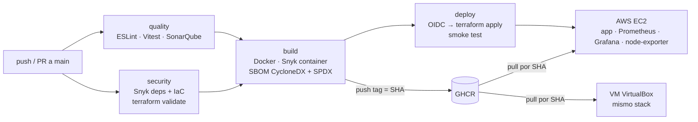

# mundose-courses-api · PIN DevOps — Proyecto 1

**CI/CD con GitHub Actions + Terraform + Docker** sobre una API de cursos e inscripciones de MundosE generada con IA.

Cada merge a `main` pasa por calidad, seguridad, build y SBOM. Si todo está en verde, Terraform despliega en AWS la imagen exacta de ese commit. La misma imagen corre en una VM VirtualBox local con Terraform.



## Mapa de la rúbrica

| Criterio (peso) | Dónde está |
| --- | --- |
| Pipeline CI/CD (25 %) | [`.github/workflows/pipeline.yml`](.github/workflows/pipeline.yml), [`destroy.yml`](.github/workflows/destroy.yml) |
| Infraestructura (20 %) | [`infra/bootstrap`](infra/bootstrap) (estado + OIDC), [`infra/envs/aws`](infra/envs/aws), [`infra/envs/local`](infra/envs/local) + [`Vagrantfile`](Vagrantfile) |
| Contenedor (15 %) | [`Dockerfile`](Dockerfile) multi-stage, no-root, healthcheck, labels OCI |
| Seguridad (20 %) | Snyk sobre dependencias, imagen y Terraform; SBOM de la imagen en CycloneDX y SPDX; OIDC sin claves; atestación de procedencia |
| Observabilidad (10 %) | [`monitoring/`](monitoring): Prometheus, alertas, Grafana con datasource y dashboard como código |
| Documentación (10 %) | este README, [`docs/SETUP.md`](docs/SETUP.md), [`docs/ai/prompt-app.md`](docs/ai/prompt-app.md) |

## La aplicación

Node.js 22 + TypeScript + Fastify. Datos en memoria: el foco del proyecto es el flujo DevOps.

| Método | Ruta | Respuesta |
| --- | --- | --- |
| GET | `/` | servicio, versión y SHA del commit |
| GET | `/courses?category=` | catálogo con vacantes |
| GET | `/courses/:id` | un curso o 404 |
| POST | `/enrollments` | 201, o 400 / 404 / 409 (ya inscripto) / 422 (sin vacantes) |
| GET | `/enrollments?courseId=` | inscripciones sin emails |
| GET | `/health`, `/ready` | liveness y readiness |
| GET | `/metrics` | métricas Prometheus |

```bash
npm ci
npm run lint && npm run typecheck && npm run test:coverage
npm run dev            # http://localhost:8080
```

## Pipeline

| Job | Qué hace | Corta el flujo si… |
| --- | --- | --- |
| `quality` | ESLint, `tsc --noEmit`, Vitest con cobertura | hay errores de lint/tipos, falla un test o la cobertura baja de 80 % |
| `sonar` | SonarQube Cloud con quality gate | el quality gate falla |
| `security` | `terraform fmt/validate`, `snyk test`, `snyk iac test` | hay vulnerabilidades high/critical |
| `build` | build, smoke test del contenedor, `snyk container test`, SBOM, push a GHCR, atestación | la imagen no arranca, corre como root o tiene vulnerabilidades high |
| `deploy` | OIDC → `terraform plan/apply` con `image_tag = SHA` → smoke test contra la IP pública | la versión nueva no responde en 6 min |

Pull requests corren todo menos el push y el deploy. Los reportes (ESLint, Snyk, SBOM, imagen `docker save`) quedan como artefactos del run.

## Infraestructura

**AWS** (`infra/envs/aws`): EC2 `t3.small` Amazon Linux 2023 con Docker Compose, Elastic IP, security group (80 público; 3000 y 9090 solo `ADMIN_CIDR`; sin SSH), rol con SSM para administrar sin llaves, IMDSv2 obligatorio, disco cifrado. El despliegue es **inmutable**: el SHA forma parte del `user_data` y cada versión reemplaza la instancia; la IP no cambia. Estado en S3 con bloqueo nativo (`use_lockfile`).

**Local** (`infra/envs/local`): VM Ubuntu 24.04 en VirtualBox creada con Vagrant; dentro, Terraform con el provider Docker levanta los mismos cuatro contenedores con la misma configuración de `monitoring/`.

```powershell
vagrant up
vagrant ssh -c "bash /vagrant/scripts/local-up.sh <sha>"
# App http://localhost:8080 · Grafana http://localhost:3000 · Prometheus http://localhost:9090
```

**Rollback:** re-ejecutar el job `deploy` de un run anterior (vuelve a aplicar ese SHA).
**Limpieza:** workflow `destroy` (escribir `destroy` para confirmar) y `vagrant destroy -f`.

## Observabilidad

Métricas RED de la API (`http_request_duration_seconds` por ruta y código), de negocio (`mundose_enrollments_total`, vacantes por curso), del proceso Node y del host (node-exporter). Dashboard **MundosE · API** provisionado al arrancar Grafana; tres alertas en Prometheus (API caída, 5xx > 5 %, p95 > 500 ms). Carga de prueba:

```bash
k6 run -e BASE_URL=http://<ip-publica> load/k6.js
```

## Seguridad: decisiones y deuda conocida

- Contenedor sin root, sistema de archivos de solo lectura, `cap_drop: ALL`, `no-new-privileges`, sin npm en runtime.
- Sin access keys de AWS en GitHub: OIDC acotado al environment `production` de este repo.
- **Deuda:** sin HTTPS (requiere dominio + ALB/ACM); la password de Grafana viaja en el `user_data` y en el estado de Terraform (mejor: SSM Parameter Store); la base `node:22-alpine` se fija por digest en E1 (`docker buildx imagetools inspect node:22-alpine`) y Dependabot la mantiene.

## Setup

Ver [`docs/SETUP.md`](docs/SETUP.md).
